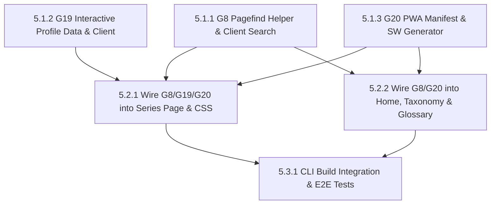

# Execution Plan 5 — Full-Text Search (`G8`), Interactive Profiles (`G19`) & Offline PWA (`G20`)

**Orchestration:** 5  
**Goals:** `G8` (Pagefind full-text search), `G19` (Interactive horizon tooltips & profile comparison), `G20` (Offline / PWA support via DST's `sw.js` pattern)  
**Baseline:** `3e117bd` (`npm test` 106/106 passing)  
**Policy:** Zero external npm dependencies; zero `node:*` imports in `src/client/*.js`; SKB JSON used as-is; `SoilProfiles.js` CJS entry `/home/andrew/workspace/SoilProfiles.js/dist/index.js` for Munsell-to-hex.

## Dependency Graph

## Wave Table

| Wave | Task ID | Title | Owned Files | Depends On |
|---|---|---|---|---|
| 1 | 5.1.1 | `G8` Pagefind helper, CLI runner & client full-text search | `src/index/pagefind.js`, `src/client/fulltext-search.js`, `test/pagefind.test.js` | — |
| 1 | 5.1.2 | `G19` Interactive horizon tooltips & profile comparison | `src/render/profile-interactive-data.js`, `src/client/profile-interactive.js`, `test/profile-interactive.test.js` | — |
| 1 | 5.1.3 | `G20` Offline PWA `manifest.json` & `sw.js` generator | `src/pwa/generate-pwa.js`, `test/pwa.test.js` | — |
| 2 | 5.2.1 | Wire `G8`/`G19`/`G20` into series page & `usdastyle.css` | `src/render/series-page.js`, `src/styles/usdastyle.css`, `test/series-page-interactive.test.js` | 5.1.1, 5.1.2, 5.1.3 |
| 2 | 5.2.2 | Wire `G8` full-text UI & `G20` PWA into Home/Taxonomy/Glossary | `src/render/home-page.js`, `src/client/home-app.js`, `src/styles/home.css`, `src/render/taxonomy-page.js`, `src/render/glossary-page.js`, `test/pwa-pages.test.js` | 5.1.1, 5.1.3 |
| 3 | 5.3.1 | Wire `G8`/`G19`/`G20` into `src/cli/build.js` & E2E tests | `src/cli/build.js`, `test/build-cli.test.js` | 5.2.1, 5.2.2 |

## Task Specifications

### Wave 1

#### 5.1.1 — `G8` Pagefind Helper, CLI Runner & Client Full-Text Search
- **`src/index/pagefind.js`**:
  - Export `buildPagefindMetaHtml(record)` returning hidden `...`, `...`, `...`, `...` for SC metadata.
  - Export `runPagefind({ outDir, runner })`: invokes `npx --no-install pagefind --site <outDir>` (or custom `runner(outDir)` in tests). If the binary is unavailable, returns `{ ok: false, skipped: true, reason }` without throwing.
- **`src/client/fulltext-search.js`** (browser ESM, zero `node:*` imports):
  - Export `loadPagefind(basePath = "./pagefind/pagefind.js")`: dynamically imports Pagefind and calls `await pf.init()`; returns `null` if unavailable.
  - Export `searchFullText(pagefind, query, { limit = 25 } = {})`: runs `pagefind.search(query)`, resolves top `limit` result `data()` objects, returns `Array<{ url, title, excerpt, meta }>`.
  - Export `renderFullTextResultsHtml(results, query)`: escapes HTML except Pagefind `<mark>` tags in `excerpt`, renders clickable links.
  - Export `initFullTextSearch(rootEl, options)`: wires input, debounced search, status/unavailable message, and results list.
- **`test/pagefind.test.js`**: Unit tests for `buildPagefindMetaHtml`, `runPagefind` (success + missing-binary fallback), `searchFullText` (mock pagefind), and `renderFullTextResultsHtml`.

#### 5.1.2 — `G19` Interactive Horizon Tooltips & Profile Comparison
- **`src/render/profile-interactive-data.js`**:
  - Import `munsellToHex` from `/home/andrew/workspace/SoilProfiles.js/dist/index.js`, plus `isPlottableHorizon` and `selectHorizonMunsell` from `./profile-sketch.js`.
  - Export `buildInteractiveProfileData(record)` returning `{ key, name, taxclname, horizons }` where each plottable horizon has `{ name, top, bottom, color, munsell, texture, pH, effervescence }`.
- **`src/client/profile-interactive.js`** (browser ESM, zero `node:*` imports):
  - Import `renderStripSvg` from `./strip-svg.js`.
  - Export `COMPARE_STORAGE_KEY = "osd-compare-series"` and `MAX_PINNED_PROFILES = 4`.
  - Export `formatHorizonTooltip(hz)`: formats horizon name, depth range (`top–bottom cm`), Munsell color, texture, pH, and effervescence.
  - Export `loadPinnedProfiles(storage)` / `savePinnedProfiles(storage, profiles)` / `togglePinnedProfile(storage, profile, max = 4)` (pure against any `{ getItem, setItem }` storage).
  - Export `renderComparisonTrayHtml(profiles, currentKey)`: renders side-by-side cards with `renderStripSvg` mini-strips, series links (`../../OSD_Docs/<L>/<KEY>.html`), taxonomic class, and remove buttons.
  - Export `initProfileInteractive(doc = document, storage = localStorage)`: parses `#osd-profile-data`, binds pointer/focus/keyboard tooltip listeners on `.osd-pedon-sketch svg rect` elements matching plottable horizons, and wires the `#osd-compare-toggle` button + `#osd-compare-tray` panel.
- **`test/profile-interactive.test.js`**: Unit tests for `buildInteractiveProfileData`, `formatHorizonTooltip`, `togglePinnedProfile` (add/remove/cap-at-4), and `renderComparisonTrayHtml`.

#### 5.1.3 — `G20` Offline PWA Manifest & Service Worker Generator
- **`src/pwa/generate-pwa.js`**:
  - Export `DEFAULT_STATIC_PATHS` (`["", "index.html", "manifest.json", "styles/usdastyle.css", "styles/home.css", "styles/taxonomy.css", "client/home-app.js", "client/search-engine.js", "client/strip-svg.js", "client/taxonomy-app.js", "client/glossary-app.js", "client/fulltext-search.js", "client/profile-interactive.js", "taxonomy/index.html", "glossary/index.html"]`) and `DEFAULT_DYNAMIC_PATHS` (`["data/search-index.json", "data/taxonomy-tree.json", "data/kst-criteria.json", "data/glossary.json"]`).
  - Export `buildWebManifest(options)`: returns pretty-printed JSON matching DST's `manifest.json` structure (name `"Official Soil Series Descriptions"`, short_name `"Soil OSD"`, theme_color `"#1a472a"`, inline SVG icon).
  - Export `buildServiceWorker({ cacheVersion, staticPaths, dynamicPaths })`: returns valid JS mirroring `/home/andrew/workspace/DST/sw.js` (`BASE = new URL('./', self.location).href`, cache-first for static, network-first with cache fallback for dynamic & OSD pages, old-cache pruning on `activate`).
  - Export `renderPwaHeadTags(prefix = "./")`: `<link rel="manifest" href="${prefix}manifest.json">` + `<meta name="theme-color" content="#1a472a">`.
  - Export `renderSwRegisterScript(prefix = "./")`: inline ``.
- Update `src/styles/usdastyle.css`: Add `.osd-horizon-tooltip`, `.osd-compare-bar`, `.osd-compare-tray`, `.osd-compare-card` styles (all hidden in `@media print`).
- Add `test/series-page-interactive.test.js`: Verify Pagefind attrs, `#osd-profile-data` JSON, compare controls, manifest link, and SW registration on rendered series HTML.

#### 5.2.2 — Wire `G8` Full-Text UI & `G20` PWA into Home, Taxonomy & Glossary Pages
- Update `src/render/home-page.js`, `src/client/home-app.js`, `src/styles/home.css`:
  - Add collapsible/tabbed Full-Text OSD Search section (`#fulltext-search-panel`) wired via `initFullTextSearch` in `home-app.js`.
  - Add `renderPwaHeadTags("./")` and `renderSwRegisterScript("./")`.
- Update `src/render/taxonomy-page.js` and `src/render/glossary-page.js`:
  - Add `renderPwaHeadTags("../")` and `renderSwRegisterScript("../")`.
- Add `test/pwa-pages.test.js`: Verify manifest + SW registration on home, taxonomy, and glossary pages, plus `#fulltext-search-panel` on home page.

### Wave 3

#### 5.3.1 — CLI Build Integration & E2E Tests
- Update `src/cli/build.js`:
  - Add `"fulltext-search.js"` and `"profile-interactive.js"` to `CLIENT_ASSET_FILES`.
  - Emit `<out>/manifest.json` and `<out>/sw.js` (using `buildWebManifest` + `buildServiceWorker` with deterministic `cacheVersion`).
  - Add `--pagefind` boolean CLI flag in `parseCliArgs()` and call `runPagefind({ outDir })` when enabled.
- Update `test/build-cli.test.js`:
  - Verify `manifest.json`, `sw.js`, `client/fulltext-search.js`, `client/profile-interactive.js` are emitted in `<out>`.
  - Verify `--pagefind` flag parsing and `data-pagefind-body` / `#osd-profile-data` in built series HTML.
  - Run full `npm test` and confirm 100% pass.
